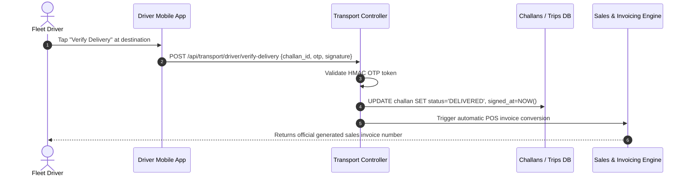

# 💻 Developer Guide: Tax Compliance, Employee Portal & Driver Fleet Architecture

This technical document details the engineering specifications, database schemas, cryptographic flows, and API architectures for **Statutory Tax Compliance (GST/ITR)**, the **HRMS Employee Self-Service Mobile Portal**, and the **Logistics Fleet Driver Subsystem**.

---

## 📑 Table of Contents
1. [Architecture Overview & Sequence Pipelines](#1-architecture-overview--sequence-pipelines)
2. [Statutory Tax Compliance Engine (`taxCompliance.controller.ts`)](#2-statutory-tax-compliance-engine-taxcompliancecontrollerts)
   - [GSTR-1 Outward Aggregation Pipeline](#gstr-1-outward-aggregation-pipeline)
   - [GSTR-3B Input Tax Credit (ITC) Reconciliation](#gstr-3b-input-tax-credit-itc-reconciliation)
   - [ITR-4 & ITR-5 Financial Statement Mapping](#itr-4--itr-5-financial-statement-mapping)
   - [GSP Authentication & Cloud Submission Bridge](#gsp-authentication--cloud-submission-bridge)
3. [HRMS Employee Mobile Portal & Geofenced Attendance (`hrms.controller.ts`)](#3-hrms-employee-mobile-portal--geofenced-attendance-hrmscontrollerts)
   - [GPS Geofence Validation: Haversine Mathematical Model](#gps-geofence-validation-haversine-mathematical-model)
   - [Hardware Device Binding & Anti-Spoofing Guard](#hardware-device-binding--anti-spoofing-guard)
   - [Attendance State Machine & Shift Logic](#attendance-state-machine--shift-logic)
   - [TIMESTAMPTZ Timezone Skew Normalization](#timestamptz-timezone-skew-normalization)
4. [Transport Logistics & Driver Fleet Engine (`transport.controller.ts`)](#4-transport-logistics--driver-fleet-engine-transportcontrollerts)
   - [Trip Assignment & Challan Manifest Packing](#trip-assignment--challan-manifest-packing)
   - [Real-Time GPS Location Beacon & Reverse Geocoding](#real-time-gps-location-beacon--reverse-geocoding)
   - [Doorstep Delivery Verification: OTP & Signature Vectors](#doorstep-delivery-verification-otp--signature-vectors)
   - [POS Sales Conversion State Machine](#pos-sales-conversion-state-machine)
5. [REST API Data Contracts](#5-rest-api-data-contracts)

---

## 1. Architecture Overview & Sequence Pipelines

The subsystems integrate operational sales and delivery events directly into legal accounting and human resource ledgers:

---

## 2. Statutory Tax Compliance Engine (`taxCompliance.controller.ts`)

Located in `backend/controllers/finance/taxCompliance.controller.ts`, mounted via `backend/routes/accounting.routes.ts`:

### GSTR-1 Outward Aggregation Pipeline
The engine processes closed sales invoices from `sales_headers` and `sales_items`:
1. **B2B Categorization**: If `customer.gstin` is present and valid, compiles invoice into Table 4 with `cpos` (Place of Supply state code), `inv_typ="R"`, and reverse charge indicator.
2. **B2C Large vs. Small**:
   - Invoices with `interstate=true` and `total_amount > 250000` mapped to Table 5.
   - All other walk-in sales summarized by rate slab and state into Table 7.
3. **HSN Summary (Table 12)**: Aggregates quantities and taxable values by `hsn_sac` code, verifying against unit quantity codes (`UQC`).

### GSTR-3B Input Tax Credit (ITC) Reconciliation
- Inward invoices from `goods_receipts` (GRN) and `purchase_orders` cross-matched against GST portal GSTR-2B data.
- Automatically calculates:
  $$\text{Net Tax Payable} = \text{Output Liability} - \min(\text{Available ITC}, \text{Output Liability})$$

### ITR-4 & ITR-5 Financial Statement Mapping
- Reads `chart_of_accounts`, `accounting_vouchers`, and `voucher_lines`.
- Separates electronic banking revenue from cash revenue to calculate Section 44AD presumptive business profits (6% on digital, 8% on non-digital).
- Auto-compiles Balance Sheet entries: Partner/Owner capital, secured loans, unsecured debt, sundry debtors, sundry creditors, and cash balances.

### GSP Authentication & Cloud Submission Bridge
- Signs outgoing XML/JSON payloads with store client credentials.
- Dispatches over mutual TLS to the authorized GSP endpoint, returning government Application Reference Numbers (`ARN`).

---

## 3. HRMS Employee Mobile Portal & Geofenced Attendance (`hrms.controller.ts`)

Located in `backend/controllers/hrms/hrms.controller.ts` and `hrms_office_portal.controller.ts`:

### GPS Geofence Validation: Haversine Mathematical Model
When an employee punches in via `POST /api/hrms/employee/punch`:
The server computes distance $d$ between the employee's GPS coordinates $(\phi_1, \lambda_1)$ and office geofence center $(\phi_2, \lambda_2)$:

$$\Delta\phi = \phi_2 - \phi_1, \quad \Delta\lambda = \lambda_2 - \lambda_1$$
$$a = \sin^2\left(\frac{\Delta\phi}{2}\right) + \cos(\phi_1)\cos(\phi_2)\sin^2\left(\frac{\Delta\lambda}{2}\right)$$
$$c = 2 \cdot \text{atan2}\left(\sqrt{a}, \sqrt{1-a}\right)$$
$$d = R \cdot c \quad (\text{where } R = 6,371,000 \text{ meters})$$

If $d > \text{office.geofence\_radius\_meters}$, the request is rejected with `HTTP 403 Forbidden: Geofence violation`.

### Hardware Device Binding & Anti-Spoofing Guard
- On initial sign-in, the employee's unique client device ID (`device_uuid`) is stored in `hr_employees.bound_device_id`.
- Subsequent punch requests from alternate hardware devices are blocked until an administrator invokes `/api/hrms/employees/:id/unbind-device`.

### Attendance State Machine & Shift Logic
- Compares punch timestamp against assigned `hr_shifts.start_time`.
- Calculates grace periods (e.g. 15 minutes), half-day threshold, overtime hours, and automatic weekly-offs (`autoWeeklyOffs`).

### TIMESTAMPTZ Timezone Skew Normalization
- All OTP expiry comparisons and punch timestamps utilize `TIMESTAMPTZ` in PostgreSQL to prevent time-drift errors across differing regional client clocks.

---

## 4. Transport Logistics & Driver Fleet Engine (`transport.controller.ts`)

Located in `backend/controllers/inventory/transport.controller.ts`:

### Trip Assignment & Challan Manifest Packing
- `POST /api/transport/assign-trip`: Groups multiple delivery challans into a unified trip manifest entity, locking vehicle status to `'ON_TRIP'`.

### Real-Time GPS Location Beacon & Reverse Geocoding
- `POST /api/transport/driver/update-location`: Ingests driver coordinates, updates active telemetry records, and asynchronously resolves reverse geocoding to human-readable street names.

### Doorstep Delivery Verification: OTP & Signature Vectors
- Generates secure 6-digit delivery verification OTP upon truck arrival.
- Validates submitted recipient code or stores base64 SVG/PNG digital touchscreen signature vectors in `delivery_challans.recipient_signature`.

### POS Sales Conversion State Machine
- When a delivery challan transitions to `'DELIVERED'`, an atomic background trigger converts the challan to an official billed invoice in `sales_headers` and settles accounts receivable under GST Rule 55.

---

## 5. REST API Data Contracts

### 1. Statutory Tax Compliance (`/api/accounting/tax`)
- `GET /api/accounting/tax/gst-summary?month=...&year=...` - Returns GSTR-1/3B summary tables.
- `GET /api/accounting/tax/gstr1-export?month=...&year=...` - Exports government-compliant GSTR-1 JSON.
- `POST /api/accounting/tax/gsp-file-gstr1` - Submits live return through GSP portal.
- `GET /api/accounting/tax/itr-summary?fiscal_year=...` - Returns ITR-4/5 financial statement schedules.
- `GET /api/accounting/tax/itr4-export?fiscal_year=...` - Exports ITR-4 schema JSON.
- `GET /api/accounting/tax/config` - Fetches store GSTIN, PAN, and tax configuration.
- `POST /api/accounting/tax/config` - Updates statutory tax configuration.
- `GET /api/accounting/tax/filings` - Lists historical filing records and ARN tokens.

### 2. Employee Mobile Portal (`/api/hrms`)
- `POST /api/hrms/employee-auth/login` - Authenticates staff with email, phone, or employee code.
- `POST /api/hrms/employee-auth/forgot-password/request-otp` - Sends 6-digit email OTP for password recovery.
- `POST /api/hrms/employee-auth/forgot-password/reset` - Verifies email OTP and resets employee password.
- `GET /api/hrms/employee/my-profile` - Retrieves active employee profile, assigned shift, and office geofence.
- `POST /api/hrms/employee/punch` - Submits geofenced GPS attendance punch with distance verification.
- `POST /api/hrms/employee/request-loan` - Submits staff advance or loan application.
- `POST /api/hrms/employee/request-salary-raise` - Submits salary increment request.
- `POST /api/hrms/employees/:id/unbind-device` - Admin action to clear bound smartphone device ID.

### 3. Logistics Fleet Driver Portal (`/api/transport`)
- `POST /api/transport/driver/login` - Driver authentication with mobile number and PIN.
- `POST /api/transport/driver/forgot-password` - Requests driver OTP password reset.
- `POST /api/transport/driver/reset-password` - Resets driver password with OTP.
- `GET /api/transport/driver/me` - Retrieves driver profile and assigned truck details.
- `GET /api/transport/driver/assigned-trips` - Fetches active trip manifest and delivery stops.
- `POST /api/transport/driver/verify-delivery` - Verifies customer doorstep delivery with OTP or signature.
- `POST /api/transport/driver/update-location` - Updates driver real-time GPS beacon coordinates.
- `GET /api/transport/fleet-tracking` - Admin real-time fleet map tracking.
