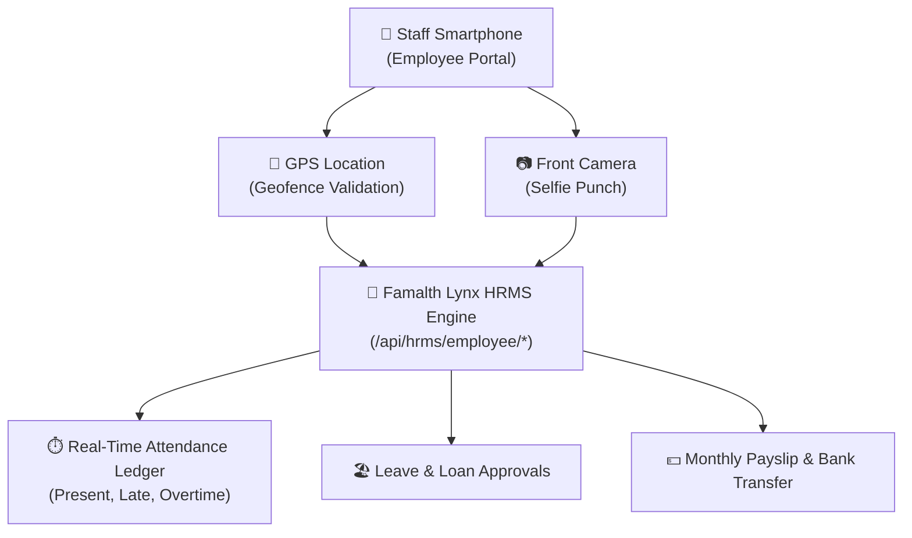

# 👥 User Guide: Employee Self-Service Mobile Portal & Geofenced HRMS

This guide explains how employees, retail cashiers, store staff, and office personnel use the **Famalth Lynx Employee Self-Service Mobile Portal** (`employee_portal_screen.dart`). It details smartphone sign-in, geofenced GPS attendance punches, leave management, loan requests, payslip downloads, and password resets via email OTP.

---

## 📑 Table of Contents
1. [Overview of Employee Self-Service](#1-overview-of-employee-self-service)
2. [First-Time Mobile Sign-In & Device Binding](#2-first-time-mobile-sign-in--device-binding)
3. [Geofenced GPS Attendance Punching](#3-geofenced-gps-attendance-punching)
   - [Office Geofence Radius Verification](#office-geofence-radius-verification)
   - [Punch-In, Break, & Punch-Out Lifecycle](#punch-in-break--punch-out-lifecycle)
   - [Selfie & Photo Verification](#selfie--photo-verification)
4. [Attendance Heatmap & Shift Calendar](#4-attendance-heatmap--shift-calendar)
5. [Leave Requests & Approval Tracking](#5-leave-requests--approval-tracking)
6. [Salary Advances, Loans & Increment Requests](#6-salary-advances-loans--increment-requests)
7. [Digital Payslip Download & Tax Summaries](#7-digital-payslip-download--tax-summaries)
8. [Password Reset via Secure Email OTP](#8-password-reset-via-secure-email-otp)
9. [Administrator Controls: Device Reset & Shift Binding](#9-administrator-controls-device-reset--shift-binding)

---

## 1. Overview of Employee Self-Service

The **Employee Self-Service Portal** eliminates paper timecards, biometric machine queues, and manual payroll inquiries by putting workplace management directly into staff hands:

---

## 2. First-Time Mobile Sign-In & Device Binding

Staff members access the portal via their personal smartphone or company tablet:

1. Launch the **Famalth Lynx App** $\rightarrow$ Tap **"Employee Portal"** on the splash screen (or navigate to `http://<server-url>/#/employee`).
2. Enter your credentials:
   - **Login Identifier**: Your registered Work Email, Mobile Number, or Employee Code (e.g. `EMP1004`).
   - **Password**: Your temporary staff password issued by HR.
3. Tap **Sign In**.
4. **Hardware Device Binding**: To prevent buddy-punching, the portal binds your account to your smartphone's hardware identifier on initial sign-in. If you change your phone, an administrator can tap **"Unbind Device"** in HRMS to authorize your new handset.

---

## 3. Geofenced GPS Attendance Punching

### Office Geofence Radius Verification
To ensure staff are physically present at the store, warehouse, or office:
- When you tap **"Punch In"**, the application queries your phone's GPS coordinates.
- Computes your exact distance to your assigned office location using the high-precision **Haversine Geofencing Formula**.
- If you are within the allowed radius (e.g., within 50 meters of the store entrance), the punch is authorized.
- If you are outside the geofence boundary, the portal displays:
  `⚠️ Geofence Warning: You are 420m away from Flagship Store. Punch denied.`

### Punch-In, Break, & Punch-Out Lifecycle
- **Punch-In**: Records the start of your shift, comparing against your assigned shift start time (e.g., 09:00 AM) to calculate early/on-time status or grace period late marks.
- **Break In / Break Out**: Logs meal and rest intervals, ensuring accurate net productive hours.
- **Punch-Out**: Records end of duty, automatically calculating total daily hours and overtime units.

### Selfie & Photo Verification
If photo verification is enabled by your store policy:
- The front camera snaps a quick verification selfie upon punching.
- Stored alongside the timestamp and GPS coordinates in your attendance record for manager audit.

---

## 4. Attendance Heatmap & Shift Calendar

From the **My Attendance** tab on your smartphone:
- **Visual Calendar Heatmap**: Displays your monthly schedule with color-coded daily badges:
  - 🟢 **Green**: Present & On-Time (Fulfilled full shift duration).
  - 🟡 **Yellow**: Grace Late Arrival or Half-Day.
  - 🔴 **Red**: Absent or Unexcused Leave.
  - 🔵 **Blue**: Approved Paid Holiday or Weekly Off.
- **Live Shift Timings**: Shows your assigned upcoming shifts, weekly roster rotations, and declared public holidays.

---

## 5. Leave Requests & Approval Tracking

Employees can apply for time off in seconds without visiting HR:

1. Open the **Leaves** tab $\rightarrow$ Tap **"+ Apply for Leave"**.
2. Select the **Leave Type** (Casual Leave, Sick Leave, Earned Leave, Maternity/Paternity).
3. Choose the **Date Range** (Full Day or Half-Day).
4. Enter the **Reason** and optionally attach a medical certificate or supporting document.
5. Tap **Submit Request**.
6. The department manager receives an instant dashboard notification. When approved or rejected, your app updates automatically and reflects the new leave balance.

---

## 6. Salary Advances, Loans & Increment Requests

Staff experiencing financial emergencies can submit formal requests directly through the app:

### Loan & Salary Advance
- Specify the required amount and proposed monthly installment deduction (EMI).
- Review repayment timelines and current company loan policy limits.
- Approved loans automatically integrate into monthly payroll deduction runs.

### Salary Review & Raise Requests
- Submit a formal review request stating achievements and performance milestones for management appraisal.

---

## 7. Digital Payslip Download & Tax Summaries

No more waiting for paper salary slips:
1. Tap the **Payroll & Payslips** tab.
2. Select any past working month (e.g. `March 2026`).
3. View itemized salary components:
   - **Earnings**: Basic Pay, House Rent Allowance (HRA), Dearness Allowance (DA), Conveyance, Overtime, and Bonuses.
   - **Deductions**: Provident Fund (PF), ESI, Professional Tax (PT), Income Tax (TDS), and Loan EMIs.
   - **Net Take-Home Pay**: Cleanly calculated and verified.
4. Click **"Download PDF"** to generate an official cryptographic vector payslip with the store's stamp and company logo.

---

## 8. Password Reset via Secure Email OTP

If you forget your portal password:
1. On the login screen, click **"Forgot Password?"**.
2. Enter your registered email address or employee code.
3. The system dispatches a **6-digit cryptographic verification OTP** to your inbox with a 10-minute expiry timer.
4. Enter the received OTP and specify your new secure password.
5. Tap **"Verify & Reset Password"**. You are instantly logged into your dashboard.

---

## 9. Administrator Controls: Device Reset & Shift Binding

In the main POS Admin HRMS module (`hrms_dashboard_screen.dart` and `employee_screen.dart`):
- **Reset Device Hardware ID**: Clear an employee's bound phone ID when they upgrade their smartphone.
- **Office Geofence Customization**: Set specific latitude, longitude, and geofence tolerance meters for each retail branch, distribution warehouse, or corporate office.
- **Live Attendance Dashboard**: Real-time staff roster showing who is currently on the floor, who is on break, and who is traveling.
