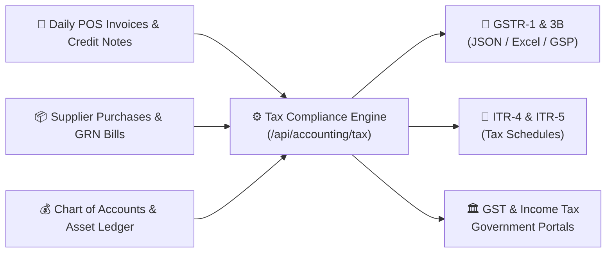

# 🧾 User Guide: Statutory GST Compliance & ITR Tax Filing Hub

This guide is designed for **Store Owners, Financial Controllers, Accountants, and Tax Consultants** using **Famalth Lynx**. It explains how to generate statutory **GST returns (GSTR-1, GSTR-3B, GSTR-9)**, reconcile **Input Tax Credit (ITC)**, export official government JSON filing payloads, and auto-compute **Income Tax Return (ITR-4 and ITR-5)** schedules directly from your store's sales and purchase ledgers.

---

## 📑 Table of Contents
1. [Overview of Tax Compliance in Famalth Lynx](#1-overview-of-tax-compliance-in-famalth-lynx)
2. [Navigating to the Compliance Hub](#2-navigating-to-the-compliance-hub)
3. [GST Compliance & Return Preparation](#3-gst-compliance--return-preparation)
   - [GSTR-1 Outward Supplies Summary](#gstr-1-outward-supplies-summary)
   - [HSN/SAC-Wise Tax Breakup](#hsnsac-wise-tax-breakup)
   - [B2B vs. B2C Invoices Classification](#b2b-vs-b2c-invoices-classification)
   - [Input Tax Credit (ITC) Reconciliation (GSTR-3B)](#input-tax-credit-itc-reconciliation-gstr-3b)
4. [Official Government JSON Export & GSP Direct Filing](#4-official-government-json-export--gsp-direct-filing)
5. [ITR Filing Engine (ITR-4 & ITR-5 Schedules)](#5-itr-filing-engine-itr-4--itr-5-schedules)
   - [Presumptive Business Income (Section 44AD / 44ADA)](#presumptive-business-income-section-44ad--44ada)
   - [Trading & Manufacturing Profit & Loss](#trading--manufacturing-profit--loss)
   - [Balance Sheet Capital & Debt Schedules](#balance-sheet-capital--debt-schedules)
   - [Fixed Asset Depreciation Schedule](#fixed-asset-depreciation-schedule)
6. [Tax Configuration & Master Setup](#6-tax-configuration--master-setup)
7. [Filing History & Audit Trail](#7-filing-history--audit-trail)
8. [Frequently Asked Questions (FAQ)](#8-frequently-asked-questions-faq)

---

## 1. Overview of Tax Compliance in Famalth Lynx

Tax filing usually requires hours of manual spreadsheet reconciliation between POS sales invoices, vendor purchase bills (GRN), and accounting journals. The **Famalth Lynx Statutory Tax Compliance Hub** bridges the gap between daily operations and legal fiscal filings:

---

## 2. Navigating to the Compliance Hub

1. Log in to **Famalth Lynx** with an **Administrator** or **Accountant** account.
2. From the left sidebar, click **Finance & Accounts** (or open the **Accounting Dashboard**).
3. Select either:
   - **GST Compliance Desk** (`gst_compliance_screen.dart`): Outward sales, HSN summaries, and government JSON uploads.
   - **ITR Filing & Tax Schedules** (`itr_filing_screen.dart`): Annual business income, depreciation calculations, and balance sheet mapping.

---

## 3. GST Compliance & Return Preparation

### GSTR-1 Outward Supplies Summary
The GST compliance screen auto-aggregates all closed sales transactions for the selected tax period (Monthly or Quarterly):
- **Gross Outward Supplies**: Total value of goods and services supplied.
- **Taxable Turnover**: Value eligible for CGST, SGST, and IGST calculations.
- **Integrated GST (IGST)**: Taxes on inter-state sales transactions.
- **Central GST (CGST) & State GST (SGST)**: Taxes on intra-state store counter sales.
- **Cess**: Additional luxury or compensation cess if applicable.

### HSN/SAC-Wise Tax Breakup
Indian fiscal law requires reporting goods by **HSN (Harmonized System of Nomenclature)** code:
- The system groups each sold item by its HSN code recorded in the Item Master.
- Shows total quantity sold, unit of measurement (UQC, e.g. PCS, KGS, BTL), total invoice value, taxable value, and rate-wise tax slabs (0%, 5%, 12%, 18%, 28%).

### B2B vs. B2C Invoices Classification
- **B2B Invoices (Table 4A, 4B, 4C, 6B, 6C)**: Registered customer sales where a valid customer GSTIN is recorded. Includes place of supply (POS) state code and reverse charge flag.
- **B2C Large (Table 5A, 5B)**: Inter-state invoices exceeding ₹2,50,000 to unregistered retail buyers.
- **B2C Small (Table 7)**: Net retail counter sales to walk-in consumers, grouped state-wise and slab-wise.
- **Credit / Debit Notes (Table 9B)**: Customer returns, invoice adjustments, and sales cancellations with original invoice linkage.

### Input Tax Credit (ITC) Reconciliation (GSTR-3B)
- Cross-references inward vendor bills logged via Goods Receiving (GRN) and Purchase Orders against your sales output tax liability.
- Displays **Eligible ITC Available** broken down into Capital Goods, Input Goods, and Input Services.
- Calculates **Net Tax Payable in Cash** after utilizing available electronic credit ledger balances.

---

## 4. Official Government JSON Export & GSP Direct Filing

Famalth Lynx provides two export options compliant with GST portal schema standards:

### 1-Click Government Portal JSON
1. Choose the **Return Period** (e.g. `April 2026` or `Q1 2026-27`).
2. Click **"Download GSTR-1 JSON"**.
3. The system generates an official payload formatted precisely for direct drag-and-drop upload into the **GST Offline Tool** or the **GST Common Portal** (`www.gst.gov.in`).
4. Validates zero-error formatting (no missing HSN codes, valid GSTIN checksums).

### Direct GSP Cloud Submission
If your store is enrolled with a recognized **GST Suvidha Provider (GSP)**:
1. Navigate to **Tax Config** $\rightarrow$ Enter your **GSP Username**, **App Key**, and **Client Secret**.
2. Click **"File via GSP"**.
3. The system performs secure TLS authentication, receives the official government filing Reference ID (`ARN`), and records it to your store's compliance log.

---

## 5. ITR Filing Engine (ITR-4 & ITR-5 Schedules)

For annual fiscal filing, the **ITR Filing Screen** compiles accounting statements into the exact schedules required by the Income Tax Department:

### Presumptive Business Income (Section 44AD / 44ADA)
- Automatically separates **Digital / Banking Turnover** (eligible for 6% presumptive profit) from **Cash Turnover** (eligible for 8% presumptive profit).
- Computes minimum presumptive gross profit threshold, alerting the business if audited accounts under Sec 44AB are required.

### Trading & Manufacturing Profit & Loss
- **Opening Stock**: Auto-pulled from the previous financial year's closing inventory balance.
- **Purchases (Net)**: Sourced directly from approved vendor invoices.
- **Direct Manufacturing & Freight Expenses**: Filtered by COA expense group.
- **Closing Stock**: Real-time valuation derived via FIFO/Average cost from the active inventory stock ledger.
- **Gross Profit & Net Profit**: Compliant with Section 28 through 43C computations.

### Balance Sheet Capital & Debt Schedules
Auto-maps ledger accounts into the statutory asset and liability buckets:
- **Proprietor / Partner Capital Account**: Opening balance, additions, withdrawals/drawings, and net profit distribution.
- **Secured & Unsecured Loans**: Outstanding bank borrowing and NBFC working capital loans.
- **Sundry Creditors (Trade Payables)**: Age-analyzed vendor balances.
- **Sundry Debtors (Trade Receivables)**: Verified customer credit balances.
- **Cash & Bank Balances**: Reconciled cash-in-hand and bank balances.

### Fixed Asset Depreciation Schedule
Computes written-down value (WDV) depreciation under **Income Tax Act Section 32**:
- Categorizes capital assets (Plant & Machinery, Furniture & Fixtures, Computers & POS Hardware, Vehicles).
- Automatically applies half-year depreciation rule (50% of allowable rate) for assets acquired and put to use for less than 180 days in the fiscal year.

---

## 6. Tax Configuration & Master Setup

In **Accounting** $\rightarrow$ **Tax Compliance** $\rightarrow$ **Settings**:

| Field | Description | Example |
| :--- | :--- | :--- |
| **Legal Trade Name** | Official legal name registered on tax portal | `Famalth Retail Solutions Pvt Ltd` |
| **Store GSTIN** | 15-character statutory GST identification number | `27AAAAA0000A1Z5` |
| **PAN Number** | 10-character Permanent Account Number | `AAAAA0000A` |
| **Filing Frequency** | Return submission period | `Monthly` or `QRMP (Quarterly)` |
| **Composition Scheme** | Toggle if registered under Section 10 | `Disabled (Regular Taxpayer)` |
| **Default HSN Code** | Fallback HSN if not specified on item | `21069099` |
| **Turnover Bracket** | Annual aggregate turnover range | `Under ₹5 Crore` / `Above ₹5 Crore` |

---

## 7. Filing History & Audit Trail

Every generated return and GSP submission is permanently stamped into the database:
- Records **Return Type** (`GSTR-1`, `GSTR-3B`, `ITR-4`), **Period**, **Filing Date**, **Filer User**, and **Acknowledgment / ARN Number**.
- Provides a 1-click **"Download Archived Payload"** button to inspect previous filings during tax department audits.

---

## 8. Frequently Asked Questions (FAQ)

### What happens if an invoice has a customer with an invalid GSTIN?
The system flags the invoice as **"Warning: Invalid GSTIN Checksum"** before JSON export and temporarily categorizes it under B2C retail sales until the cashier corrects the customer profile.

### Can I export the tax report to Excel for my Chartered Accountant?
Yes! Click the **"Export Excel / CSV"** button at the top right of the GST Compliance screen to obtain an itemized multi-tab workbook ready for your tax consultant.

### How does credit cancellation affect GST liability?
When an invoice is voided or returned in POS, Famalth Lynx issues an automated Credit Note with the original invoice number, ensuring your net tax liability in Table 9B is deducted correctly.
