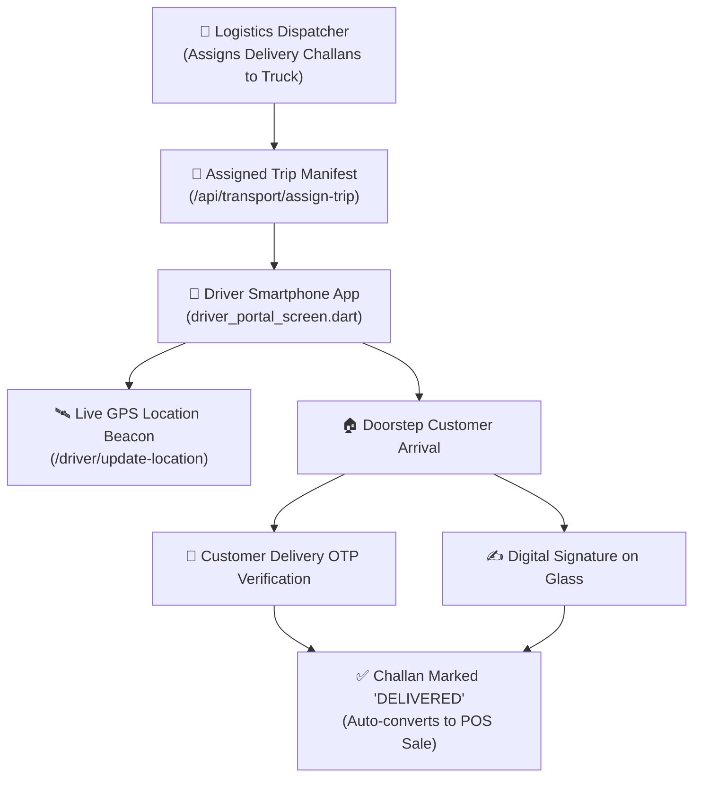

# 🚚 User Guide: Logistics Fleet Driver App & Doorstep Verification

This guide explains how commercial truck drivers, delivery van operators, and logistics dispatchers use the **Famalth Lynx Driver Mobile Portal** (`driver_portal_screen.dart`). It covers driver smartphone sign-in, daily trip loading manifests, live GPS route tracking, doorstep customer OTP verification, digital signature capture, and Cash-on-Delivery (COD) cash reconciliation.

---

## 📑 Table of Contents
1. [Overview of the Logistics Driver Portal](#1-overview-of-the-logistics-driver-portal)
2. [Driver Sign-In & Authentication](#2-driver-sign-in--authentication)
3. [Trip Assignment Manifest & Vehicle Inspection](#3-trip-assignment-manifest--vehicle-inspection)
4. [Live GPS Location Beacon & Route Navigation](#4-live-gps-location-beacon--route-navigation)
5. [Doorstep Delivery Verification](#5-doorstep-delivery-verification)
   - [Customer OTP Code Verification](#customer-otp-code-verification)
   - [Customer Digital Signature on Glass](#customer-digital-signature-on-glass)
   - [Partial Drops & Damage Rejections](#partial-drops--damage-rejections)
6. [Cash-on-Delivery (COD) Collection & Trip Closure](#6-cash-on-delivery-cod-collection--trip-closure)
7. [Fleet Manager Live Tracking Console](#7-fleet-manager-live-tracking-console)
8. [Frequently Asked Questions (FAQ)](#8-frequently-asked-questions-faq)

---

## 1. Overview of the Logistics Driver Portal

The **Driver Mobile Portal** connects wholesale dispatch warehouses and retail delivery operations directly to drivers on the road:

---

## 2. Driver Sign-In & Authentication

Commercial drivers access the mobile portal on their phone or in-cab tablet:

1. Open the application $\rightarrow$ Tap **"Driver Portal"** on the splash screen (or navigate to `http://<server-url>/#/driver`).
2. Enter your credentials:
   - **Driver Identifier**: Registered Mobile Number or Driver ID (e.g. `DRV-102`).
   - **Password**: Your driver PIN or account password.
3. Tap **Sign In**.
4. **Forgot Password?**: Drivers can tap **"Forgot Password?"** to receive a one-time verification code on their registered mobile number and set a new password.

---

## 3. Trip Assignment Manifest & Vehicle Inspection

Once logged in, the driver sees their active assignment:
- **Vehicle Information**: Assigned truck plate number, vehicle model, max payload capacity, and fuel status.
- **Pre-Trip Checklist**: Drivers complete a quick safety audit (Tire pressure, Brakes, Fuel level, Cargo lock seal) before rolling out.
- **Loading Manifest**: Itemized summary of all Delivery Challans loaded into the vehicle with destination addresses, customer contact names, and total cartons/units.

---

## 4. Live GPS Location Beacon & Route Navigation

While in transit:
- **Background Location Beacon**: The smartphone app periodically sends encrypted GPS coordinates to `/api/transport/driver/update-location`.
- **Reverse Geocoding**: The server automatically resolves the driver's coordinates into readable street addresses and milestone checkpoints.
- **Turn-by-Turn Navigation**: Tap the **"Navigate"** icon on any destination stop to launch Google Maps, Apple Maps, or Waze with optimal traffic routes.
- **1-Tap Customer Dialer**: Call recipient store managers directly from the app to notify them of approaching delivery trucks without exposing private driver numbers.

---

## 5. Doorstep Delivery Verification

To prevent false delivery disputes and ensure full audit compliance under GST Rule 55:

### Customer OTP Code Verification
1. When the driver arrives at the customer store or unloading dock, tap **"Verify Delivery"**.
2. The customer receives an automated **6-digit Delivery OTP** on their registered mobile phone via SMS / WhatsApp.
3. The driver asks the store manager for the OTP and enters it into the app.
4. The backend verifies the cryptographic code instantly, confirming that the delivery occurred with the authorized recipient.

### Customer Digital Signature on Glass
1. If OTP delivery is not enabled or in offline dock areas, the driver presents their mobile screen.
2. The receiving store manager writes their signature directly on the touchscreen canvas.
3. The signature vector is timestamped and attached to the digital delivery challan.

### Partial Drops & Damage Rejections
If some cartons are damaged or missing:
- The driver taps **"Item Discrepancy"** $\rightarrow$ adjusts the accepted quantity $\rightarrow$ snaps a photo of the damaged goods.
- An automatic differential adjustment is logged, notifying dispatch and revising the final billing invoice.

---

## 6. Cash-on-Delivery (COD) Collection & Trip Closure

For cash or credit on delivery shipments:
- The app shows the exact **Amount to Collect** for each stop.
- Records payment method (Cash, UPI QR scan, or On-Account Credit).
- **Return to Base (Release Trip)**: Upon returning to the central warehouse, the driver submits collected cash to the head cashier, taps **"Complete & Release Trip"**, and the truck is marked ready for the next dispatch.

---

## 7. Fleet Manager Live Tracking Console

From the main POS Admin Console (**Transport & Logistics** $\rightarrow$ **Fleet Live Tracking**):
- Dispatchers view a real-time map displaying all trucks in transit.
- Color-coded vehicle icons:
  - 🟢 **Moving**: Active trip en route.
  - 🟡 **At Customer**: Unloading and verifying doorstep OTP.
  - 🔵 **Returning**: Inward transit back to depot.
  - ⚪ **Idle**: Available in yard for new trip assignment.

---

## 8. Frequently Asked Questions (FAQ)

### What happens if the driver has no internet at the delivery basement?
The Driver Portal operates in **Offline Fallback Mode**. The customer's digital signature and timestamp are saved in local storage. As soon as the driver drives up to road level with cell reception, the delivery confirmation automatically syncs to the server.

### Can a single trip have multiple delivery challans for different stores?
Yes! Dispatchers can group dozens of delivery challans into a single route run (`/api/transport/assign-trip`). The driver sees an ordered sequence of delivery stops and checks off each stop sequentially.
